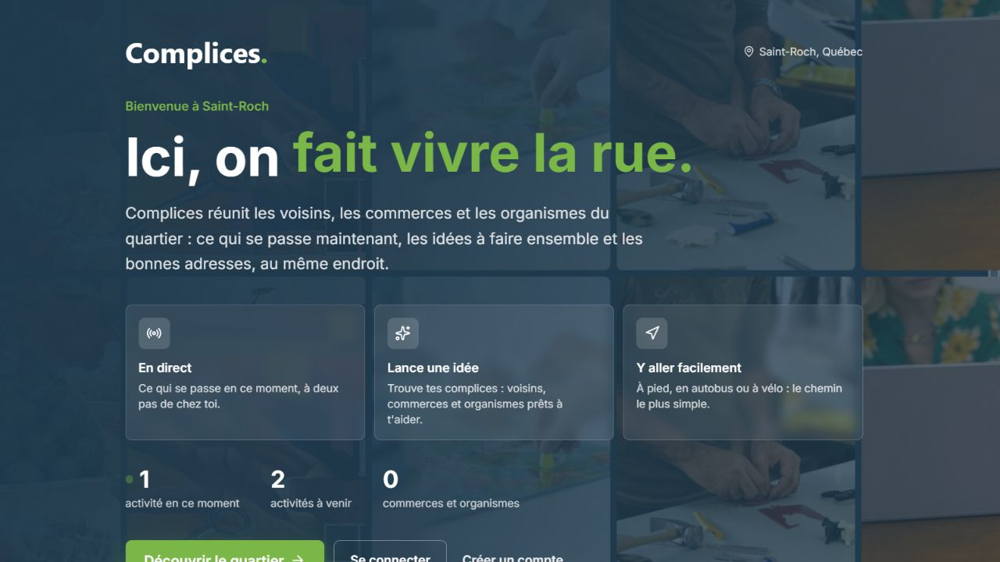
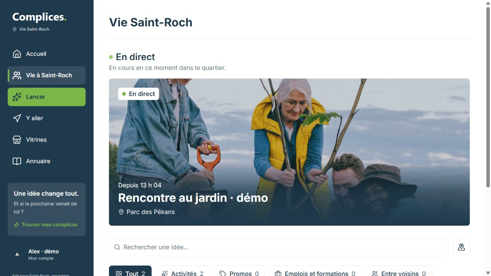
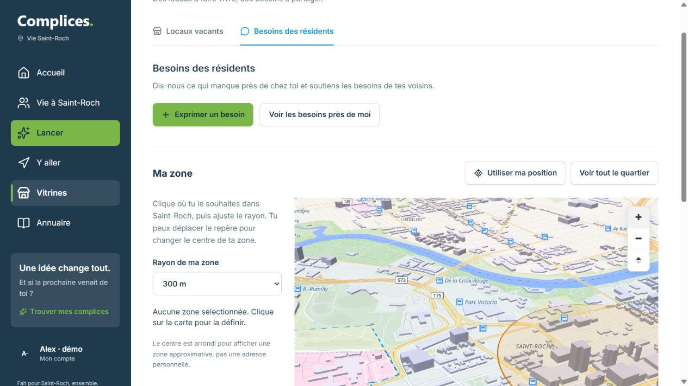
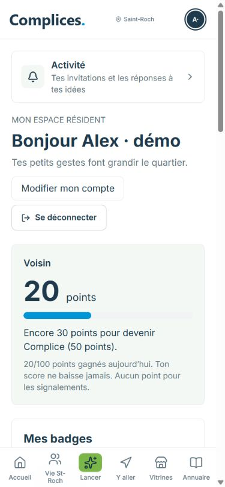
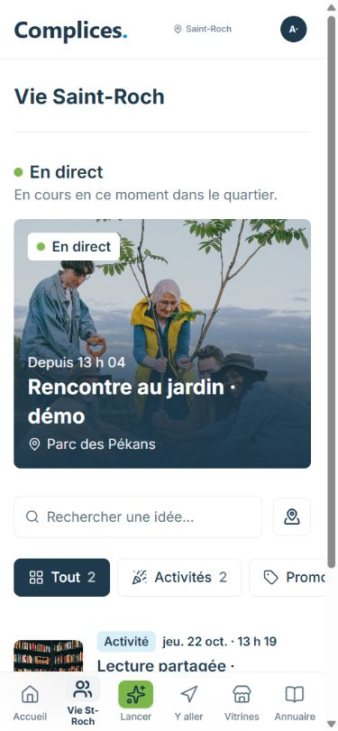

# Captures réelles du prototype

Captures du 21 octobre 2026 depuis une installation locale isolée, avec les comptes et publications fictifs créés par `npm run demo:seed`. Aucune maquette Figma ni interface générée n'est présentée comme un écran fonctionnel.

## Accueil

## Vie du quartier

## Vitrine

## Profil résident sur mobile

## Vie du quartier sur mobile

Les fonds de carte et images illustratives conservent leurs attributions dans l'application et dans `public/images/activities/CREDITS.md`. Les vues sont des captures brutes, sans ajout d'éléments d'interface. Les nombres et noms visibles appartiennent au jeu de démonstration et ne mesurent pas l'usage réel du produit.
